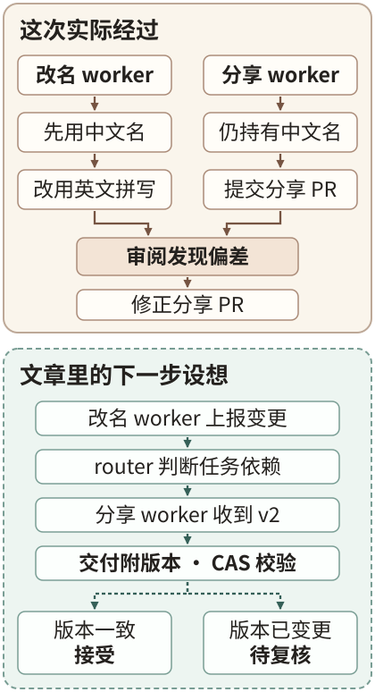

最近在测 DeepSeek Super Agent 编程，我就拿了个刚初始化的个人博客仓库来试。先让 DS Bot 从第一性原理出发，捋一捋这个博客该做点什么。它提了几个需求，其中两个特别朴素。把首页显示的仓库名换成我的名字，好歹一眼能看出是个人博客。再加几个分享组件。

改名那条先合并了。起初用的是我的中文大名，我看了看，觉得不好听，又换成了英文拼写。

然后分享组件的 PR 提上来了。里面用的还是我的中文大名。

巧的是，我正好用了 DS Bot 做 PR 审阅。它知道我后来换了拼写，就在那条 PR 下指出了这个问题。后面这处偏差也修掉了，我几乎没插手。

复盘的时候，我最想弄清楚的是，做分享的那个 Agent 怎么还拿着旧名字？

我用的这套 Super Agent 里，router 负责派活，worker 负责做。它有一个叫「订阅直通」的策略。同一个话题里，后续评论会直接交给已经接手的 worker。你顺嘴补一句「这块再改一下」，不用让 router 重新派一次活。

我改名字的那句话，就这么送到了改名的 worker 手里。做分享的 worker 在另一个话题，手上的需求还停留在中文名那一版。

从它的角度看，用中文名完全合理。它缺的就一句话。偏偏这句话发在别处，改的是两个任务都要用的东西。

这次有 DS Bot 在审阅时看到了两边的差异。下一次，能不能在我刚改主意的时候，就把这件事交给 Super Agent 自己处理？

收到改名的 worker 最先知道我改了什么。它可以多判断一步，这个改动有没有可能影响别的需求，或者已经定好的产品设计？有这个可能，就把变更报回 router，告诉它原来是什么、现在改成什么、哪些地方可能也要跟着动。

谁真会受影响，再由 router 结合手里的任务和依赖关系来判断。放回这个博客，只要 router 知道分享组件会用到展示名，就能把英文拼写送到分享 worker 的话题里。我还是只说一遍「换个名字」，做分享的 worker 也有机会在写完之前收到。

还有一个挺现实的时间差。改名已经生效，通知还在路上，分享 PR 正好要合并。怎么办？

顺着 Raft 的一篇文章，我想到并发编程里一个熟悉的操作，CAS，Compare-and-Swap，比较并交换。[Raft 的文章](https://raft.build/zh-cn/resources/blog/is-having-agents-in-the-room-meant-to-be-chaotic/)

套回这次改名，把中文名那一版记作 `v1`，英文拼写记作 `v2`。分享 worker 是拿着 `v1` 开工的，交付时就带上这个版本。系统接受产物的条件是，当前的展示名版本仍然是 `v1`。如果已经改到 `v2`，就把 PR 标成待复核，让 worker 看过新决定再回来确认。

比较版本和接受结果得在同一个原子操作里完成。要是先查一眼版本，再另走一步去合并，这两步之间还够我再改一回主意。

这两个办法是这次测试之后冒出来的设想。下回我想故意挑分享 PR 快合并的时候，再改一次博客名。

这次就说一遍。看看新名字能不能送到做分享的 worker 手里，也看看那份写着我中文大名的 PR 会停在哪一步。
